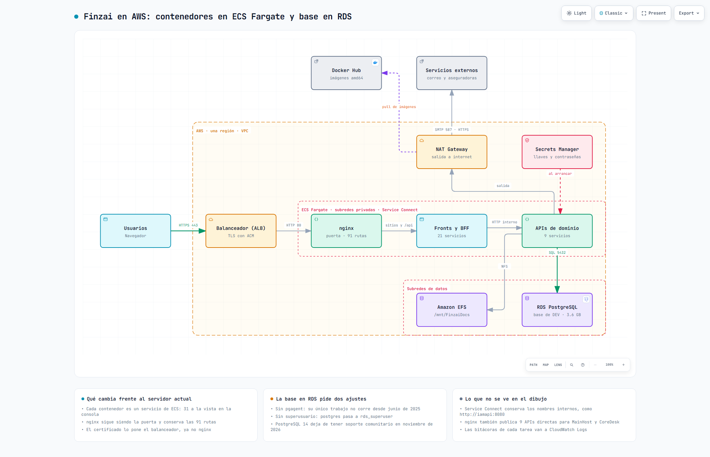

# Solicitud de infraestructura en AWS — Finzai en ECS Fargate con base en RDS

**Para:** administración de la cuenta de AWS
**Solicita:** C. Flores (cflores@tekprovider.net)
**Fecha:** 2026-10-13

## Qué se va a montar

La plataforma Finzai son **31 contenedores** que hoy corren juntos en un servidor. En AWS cada uno será un
servicio de **ECS Fargate**, la base de datos pasa a **RDS PostgreSQL** y los archivos a **EFS**. La entrada
es un balanceador con HTTPS; detrás, un contenedor de nginx reparte las rutas hacia los demás.

Archivos de este paquete:

| Archivo | Para qué |
|---|---|
| `solicitud-infraestructura.md` | Este documento: lo que hay que dar de alta |
| `servicios.md` | Los 31 servicios: imagen, puerto, tamaño y variables de cada uno |
| `arquitectura.html` | El diagrama, interactivo; se abre en cualquier navegador |
| `arquitectura.png` | El mismo diagrama como imagen |

## Datos que acompañan la solicitud

| Dato | Valor |
|---|---|
| Región | «por definir: la que ya use la organización» |
| Nombre del ambiente (aquí `<ambiente>`) | «por definir, p. ej. `finzai-demo`» |
| Subdominio (aquí `<subdominio>`) | «pendiente; detiene solo los puntos 3.1 y 3.4» |
| Direcciones de origen que podrán entrar | «por definir: direcciones públicas de la oficina o de la VPN» |
| Persona que operará el ambiente | cflores@tekprovider.net |

## Quién hace qué

| Parte | Responsable |
|---|---|
| Puntos 1 al 9 de este documento | Administración de AWS |
| Definiciones de tarea y servicios de ECS (`servicios.md`) | El solicitante, con los permisos del punto 9; o la administración, si lo prefiere |
| Imagen de nginx, carga de la base y de los archivos, valores de los secretos | El solicitante |

## 1. Red

| Recurso | Especificación |
|---|---|
| VPC | Una, en **dos zonas de disponibilidad** (el balanceador y RDS lo exigen) |
| Subredes públicas | 2, una por zona. Alojan el balanceador y el NAT Gateway |
| Subredes privadas de aplicación | 2, una por zona. Alojan las tareas de ECS |
| Subredes privadas de datos | 2, una por zona. Alojan RDS y los puntos de montaje de EFS. Pueden ser las mismas de aplicación si se prefiere simplificar |
| Internet Gateway | Uno, con ruta desde las subredes públicas |
| NAT Gateway | **Uno** (no uno por zona), con su dirección elástica, y ruta desde las subredes privadas |

Las tareas necesitan salir a internet por el NAT para tres cosas: bajar imágenes de Docker Hub, mandar
correo por `smtp.office365.com:587` y consultar servicios externos de aseguradoras por HTTPS.

## 2. Grupos de seguridad

| Grupo | Entrada | Salida |
|---|---|---|
| `alb` | TCP 443 y TCP 80, **solo** desde las direcciones de origen de la tabla de arriba | Al grupo `ecs`, TCP 80 |
| `ecs` | Del grupo `alb`, TCP 80. De sí mismo, TCP 80 y 8080 (los servicios se llaman entre ellos) | Todo |
| `rds` | Del grupo `ecs`, TCP 5432 | — |
| `efs` | Del grupo `ecs`, TCP 2049 | — |

Mientras dure la carga inicial (punto 8), `rds` y `efs` aceptan también a la instancia temporal.

## 3. Entrada

| # | Recurso | Especificación |
|---|---|---|
| 3.1 | Certificado (ACM) | Público, para `<subdominio>`, validado por DNS |
| 3.2 | Balanceador de aplicación (ALB) | Expuesto a internet, en las 2 subredes públicas, grupo `alb`. Tiempo de inactividad: 120 s |
| 3.3 | Escuchas | 443 con el certificado, que reenvía al grupo de destino. 80, que redirige a 443 |
| 3.4 | Registro DNS | `<subdominio>` hacia el balanceador (alias en Route 53, o CNAME si el DNS está fuera) |
| 3.5 | Grupo de destino | Tipo **IP**, protocolo HTTP, puerto 80. Comprobación de salud: `GET /salud`, respuesta 200. Lo usa únicamente el servicio `nginx` |

El balanceador termina HTTPS y entrega HTTP a nginx. No hacen falta reglas por ruta: las 91 rutas las
resuelve nginx.

## 4. ECS

| # | Recurso | Especificación |
|---|---|---|
| 4.1 | Clúster | `finzai-<ambiente>`, solo Fargate |
| 4.2 | Espacio de nombres de Service Connect | `finzai-<ambiente>`, por omisión del clúster. Los servicios se alcanzan por alias corto, p. ej. `http://iamapi:8080` |
| 4.3 | Rol de ejecución de tareas | `AmazonECSTaskExecutionRolePolicy`, más lectura de los secretos del punto 7 |
| 4.4 | Rol de tarea | Los permisos de `ssmmessages` que pide ECS Exec, para abrir una consola dentro de un contenedor al diagnosticar |
| 4.5 | Bitácoras | Grupo de CloudWatch Logs `/ecs/finzai-<ambiente>`, retención de 30 días |
| 4.6 | Repositorio de imágenes (ECR) | Uno, `finzai-nginx`. Las otras 30 imágenes se bajan de Docker Hub |
| 4.7 | Servicios | 31, descritos en `servicios.md`. Todos: Fargate, Linux x86_64, una tarea deseada, subredes privadas de aplicación, grupo `ecs`, **sin** dirección pública, Service Connect como cliente y servidor, ECS Exec habilitado |

En total son 8.5 vCPU y 31.5 GB de memoria repartidos en las 31 tareas. No se pide autoescalado.

Las imágenes están en Docker Hub, cuenta `danielsancheztekprovider1`, publicadas para x86_64. Si los
repositorios son privados, las definiciones de tarea usan las credenciales del secreto `dockerhub` (punto 7).

## 5. Base de datos (RDS)

| Dato | Especificación |
|---|---|
| Motor | PostgreSQL **14**, la versión menor más reciente. La base de origen es 14.24 |
| Clase | `db.t4g.medium` (2 vCPU, 4 GB) |
| Disponibilidad | Una sola zona |
| Almacenamiento | 20 GB `gp3` cifrado, con crecimiento automático hasta 50 GB. La base pesa 3.6 GB |
| Red | Grupo de subredes con las 2 subredes de datos, grupo `rds`, **sin** acceso público |
| Usuario maestro | `postgres`. La contraseña la define la administración y la guarda en el secreto del punto 7 |
| Base inicial | Ninguna: `TEKCLOUD_DEV` se crea al restaurar el respaldo |
| Respaldos | Automáticos, 7 días. Protección contra borrado activada |

Extensiones que usa la base y que RDS admite: `vector`, `uuid-ossp`, `pageinspect` y `pg_stat_statements`.
Las crea el solicitante al restaurar; no requieren un grupo de parámetros especial.

PostgreSQL 14 deja de tener soporte de la comunidad en noviembre de 2026. Se pide la 14 porque es la versión
de la base de origen; conviene que la administración revise hasta cuándo la cubre RDS sin costo de soporte
extendido.

## 6. Archivos (EFS)

| Dato | Especificación |
|---|---|
| Sistema de archivos | Uno, cifrado, de uso general |
| Puntos de montaje | Uno en cada subred de datos, grupo `efs` |
| Punto de acceso | Ruta `/FinzaiDocs`, usuario y grupo POSIX 1000, permisos de creación 755 |

Lo monta un solo servicio, `filemanagementapi`, en `/mnt/FinzaiDocs`.

## 7. Secretos (Secrets Manager)

La administración crea los secretos; los valores los carga el solicitante.

| Secreto | Contenido | Quién lo lee |
|---|---|---|
| `finzai/<ambiente>/bd-cadena-conexion` | Cadena de conexión completa a RDS | Las 9 APIs |
| `finzai/<ambiente>/iam-key-protection` | Llave de protección del servicio de identidad | `iamapi` |
| `finzai/<ambiente>/dockerhub` | Usuario y token de Docker Hub. Solo si los repositorios son privados | El rol de ejecución, al bajar imágenes |

## 8. Apoyo para la carga inicial

Hacen falta una sola vez, para traer la base y los archivos. Se eliminan después.

| Recurso | Especificación |
|---|---|
| Bucket S3 | Privado, cifrado, con expiración de objetos a 30 días. Ahí se suben el respaldo de la base (unos GB) y los archivos de documentos |
| Instancia temporal | `t3.small`, Ubuntu Server 24.04, en una subred privada de aplicación, con Session Manager (`AmazonSSMManagedInstanceCore`) y lectura del bucket. Con acceso a `rds` por 5432 y a `efs` por 2049 |

Con esto no hace falta conectar AWS con la red de la oficina.

## 9. Acceso del operador

Para cflores@tekprovider.net, limitado a los recursos de este ambiente:

| Permiso | Para qué |
|---|---|
| ECS: ver el clúster; registrar definiciones de tarea; crear, actualizar y reiniciar servicios; ECS Exec | Dar de alta y operar los 31 servicios |
| `iam:PassRole` sobre los dos roles del punto 4 | Sin él no se puede registrar una definición de tarea |
| ECR: subir imágenes a `finzai-nginx` | Publicar la imagen de nginx |
| Secrets Manager: escribir el valor de los secretos del punto 7 | Cargar la cadena de conexión y las llaves |
| CloudWatch Logs: lectura del grupo del punto 4.5 | Ver las bitácoras |
| S3: subir y bajar objetos del bucket del punto 8 | Traspaso del respaldo y los archivos |
| Session Manager sobre la instancia temporal | Restaurar la base y copiar los archivos |
| RDS y balanceador: solo lectura | Ver estado y salud |

## 10. Recomendado (no bloquea el arranque)

| Recurso | Especificación |
|---|---|
| Zona privada de Route 53 `finzai.net` | Asociada a la VPC, con un registro A de `finzai.net` hacia `127.0.0.1`. Las imágenes traen de fábrica direcciones del ambiente de desarrollo (`finzai.net`); con esto, una que se haya quedado sin corregir falla a la vista en vez de llamar a ese ambiente. Efecto: dentro de la VPC dejan de resolverse los demás nombres de `finzai.net`; las tareas no los necesitan |
| Alarmas | Tareas en ejecución menores que las deseadas en cualquier servicio; almacenamiento libre de RDS |
| Alerta de presupuesto | Aviso al solicitante si el gasto mensual del ambiente pasa de un tope |
| Etiquetas | `Proyecto=Finzai` y `Ambiente=<ambiente>` en todos los recursos |

## 11. Lo que NO hace falta

- Instancias EC2 permanentes, EKS o grupos de autoescalado.
- RDS en varias zonas o réplicas de lectura.
- Un NAT Gateway por zona.
- API Gateway, CloudFront o WAF.
- Redis, colas o cualquier otro servicio administrado: ninguno de los 31 contenedores los usa.
- SES: el correo sale por el proveedor actual.
- VPN o conexión dedicada con la red de la oficina.

## 12. Lo que necesito recibir

1. Región y cuenta.
2. Nombre del clúster y del espacio de nombres de Service Connect.
3. Identificadores de las subredes privadas de aplicación y del grupo de seguridad `ecs`.
4. ARN del rol de ejecución y del rol de tarea.
5. ARN del grupo de destino del balanceador y nombre DNS del balanceador.
6. Dirección (endpoint) de RDS.
7. Identificador del sistema de archivos EFS y de su punto de acceso.
8. ARN de los secretos.
9. Dirección del repositorio de ECR y nombre del bucket.
10. Identificador de la instancia temporal y cómo entro a la consola (dirección de inicio de sesión y rol asignado).

## 13. Costo aproximado

Del orden de **450 a 500 USD al mes**, a precio de lista en `us-east-1` y encendido todo el mes:

| Concepto | USD al mes |
|---|---|
| Fargate: 8.5 vCPU y 31.5 GB | ≈ 350 |
| RDS `db.t4g.medium` y su almacenamiento | ≈ 50 |
| NAT Gateway | ≈ 33, más el tráfico |
| Balanceador | ≈ 20 |
| EFS, secretos, bitácoras y direcciones públicas | ≈ 20 |

Es una estimación: el dato firme sale de la calculadora de AWS con la región elegida. Los tamaños de las
tareas son iniciales y se ajustan al ver el consumo real.
